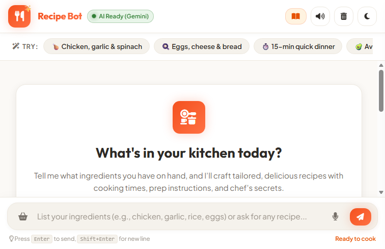

# 🍳 Recipe Bot

> An AI-powered culinary assistant that suggests delicious recipes based on the ingredients you already have in your kitchen.

[](https://nodejs.org/)
[](https://expressjs.com/)
[](https://aistudio.google.com/)
[](https://developer.mozilla.org/en-US/docs/Web/JavaScript)
[](https://opensource.org/licenses/ISC)

---

## 📸 Preview



---

## ✨ Features

- **🥫 Ingredient-Based Recipe Suggestions**: Enter the ingredients you have on hand (e.g., *"chicken, garlic, spinach"*), and Recipe Bot recommends tailored dishes along with any extra pantry staples needed.
- **🤖 Powered by Gemini AI**: Leverages Google's Gemini models for custom chef advice, step-by-step cooking instructions, ingredient substitutions, and dietary adjustments.
- **💬 Interactive Chat UI**:
  - Clean and responsive conversation interface with distinct user and bot message bubbles.
  - Rich Markdown formatting support (headings, bullet points, numbered instructions, bold highlights).
  - Quick-suggestion chips for one-click prompts.
  - Slide-out recipe drawer to browse the curated recipe book.
  - Light / Dark theme toggle for comfortable viewing.
  - Built-in voice dictation for hands-free kitchen interaction.
- **📖 Curated Local Recipe Database**: Includes a built-in collection of multi-cuisine recipes (`data/data.json`) for instant offline matching and fallback suggestions.

---

## 🛠️ Tech Stack

### Frontend
- **HTML5**: Semantic layout and chat interface structure.
- **CSS3**: Modern responsive styling, culinary design system, themes, and animations.
- **JavaScript (Vanilla JS / ES6+)**: Chat logic, state handling, speech recognition, and sound effects.

### Backend
- **Node.js**: Asynchronous JavaScript runtime environment.
- **Express.js**: REST API server handling chat completions and recipe endpoints.

### AI & APIs
- **Google Gemini API** (`@google/generative-ai`): Generates contextual culinary recommendations and chef-level tips.

---

## 🚀 Getting Started

Follow these steps to set up and run Recipe Bot locally.

### Prerequisites

- **Node.js** (v18.0.0 or higher recommended)
- **npm** (comes bundled with Node.js)
- A **Google Gemini API Key** (Get a free API key from [Google AI Studio](https://aistudio.google.com/))

---

### Step-by-Step Setup

#### 1. Clone the repository
```bash
git clone https://github.com/Roshiniv19/recipe--bot.git
cd recipe--bot
```

#### 2. Install dependencies
Install project dependencies from the root directory:
```bash
npm install
```

> **Note**: This will automatically install dependencies for the root and backend services.

#### 3. Create `.env` from `.env.example`
Copy the environment template file:

- **Linux / macOS**:
  ```bash
  cp .env.example .env
  ```
- **Windows (Command Prompt / PowerShell)**:
  ```powershell
  copy .env.example .env
  ```

Open the newly created `.env` file in your editor and add your Gemini API key:
```env
GEMINI_API_KEY=your_gemini_api_key_here
GEMINI_MODEL=gemini-3.8-flash
PORT=3000
```

> ⚠️ **Important**: Never commit your real API key to version control. The `.gitignore` file is preconfigured to keep `.env` private.

#### 4. Start the application
Launch the Express server:
```bash
npm start
```

For development with automatic server reloading:
```bash
npm run dev
```

#### 5. Open in browser
Once the server starts, navigate to:
```text
http://localhost:3000
```

---

## 📁 Project Structure

```text
recipe--bot/
├── backend/
│   ├── package.json          # Backend dependencies & scripts
│   └── server.js             # Express server & Gemini API integration
├── data/
│   └── data.json             # Curated recipe database (ingredients, steps, cuisine)
├── frontend/
│   ├── app.js                # Frontend application logic & chat handlers
│   ├── index.html            # Main HTML document & chat layout
│   └── style.css             # UI styling, responsive design & themes
├── screenshots/
│   └── chat.png              # Application screenshot
├── .env.example              # Example environment configuration template
├── .gitignore                # Git ignore rules (protects credentials & node_modules)
├── package.json              # Root project configuration & scripts
└── README.md                 # Project documentation
```

---

## 👩‍💻 Author

**Roshini V**
- GitHub: [@Roshiniv19](https://github.com/Roshiniv19)

---

## 📄 License

This project is open source and available under the [ISC License](LICENSE).
